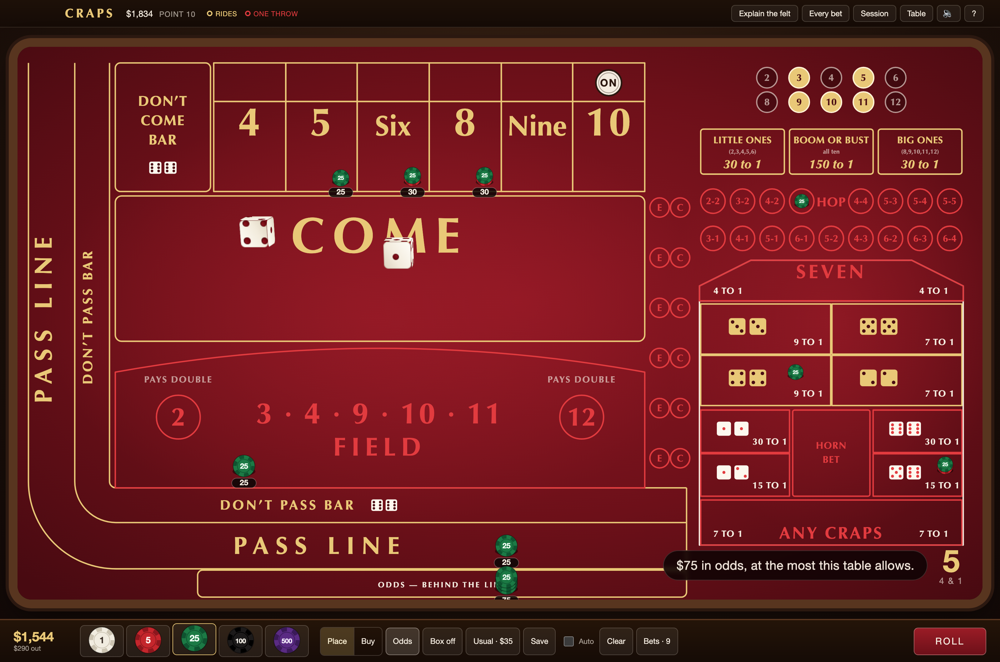
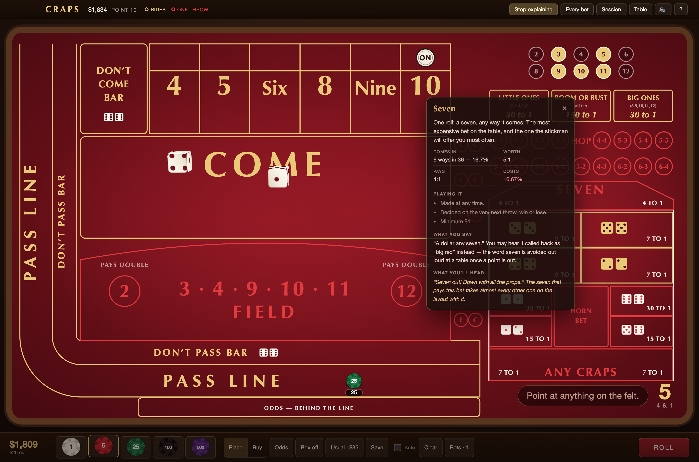

# Craps

A Vegas craps table that runs in the browser. Every bet printed on the felt can
be played. The table refuses any bet a dealer would refuse and says why. Each
roll's result is drawn from the browser's cryptographic random source before the
dice are thrown.

**Play it: [lhstart.com/games/craps](https://lhstart.com/games/craps/)**



There are no accounts and no advertising, and the game makes no network requests
of its own. After the first load it works offline.

## Running it

```bash
npm install
npm run dev
```

`npm run build` writes a self-contained site to `dist/`. It runs from any folder
and any URL path, with no server.

## The table

The layout is copied from photographs of a real burgundy felt. The box numbers
are printed 4, 5, Six, 8, Nine and 10. It is not a crapless table, and it has no
Big 6 or Big 8 because the photographed table does not have them.

| | |
| --- | --- |
| **The line** | Pass, Don't Pass (bar 12), Come, Don't Come, and odds behind any of them |
| **The box** | Place, Buy and Lay on all six numbers |
| **The field** | 2 · 3 · 4 · 9 · 10 · 11 · 12, with 2 and 12 both paying double |
| **The centre** | Any Seven, Any Craps, Aces, Ace Deuce, Yo, Boxcars, the Horn, C & E |
| **Hardways** | 4 and 10 at 7:1, 6 and 8 at 9:1 |
| **Hops** | All seventeen circles: four doubles at 30:1, thirteen easy ways at 15:1 |
| **The bonus row** | Little Ones, Big Ones and Boom or Bust, on one shared tracker |

### Bet colours

On a real felt the colours are branding and carry no meaning. On the
photographed table they are misleading. The come box is red like the one-roll
bets, but a come bet stays up as long as a line bet. The field is gold like the
box numbers, but it is decided on the next roll. These are the two bets new
players most often misunderstand.

In this game, **gold means the bet stays up across rolls** and **red means it is
decided in one roll**. Cream marks things that are not bets: payouts, printed
dice and markers. So the hardways are gold even though they sit in the centre,
and the field is red.

This is the only deliberate change from the photographed layout.

## Table rules

- **Bet increments.** Place bets on 6 and 8 must be multiples of $6, so the 7:6
  payout comes out in whole dollars. Place bets on 5 and 9 must be multiples of
  $5. Odds on a 5 or 9 must be even amounts. A bet that cannot be paid in whole
  dollars is refused, and the table gives a valid amount, for example *"the six
  pays in $6 steps, make it $30"*.
- **Odds limits.** The default is 3-4-5x: 3x on 4 and 10, 4x on 5 and 9, and 5x
  on 6 and 8. At these limits every winning point pays six times the flat bet.
  Lay odds on the don't side are capped at whatever amount wins six times the
  flat bet. Table settings offer limits from 1x to 100x.
- **Odds placement.** Odds chips go on the apron behind the flat bet, not beside
  it. They are the only chips there, so a player's odds can be read from the
  felt.
- **Working and off.** Place bets, buys, hardways and come odds are off on the
  come-out roll unless you turn them on. On a come-out seven, a come bet on a
  number loses, but its odds are returned. Lay odds on a don't come bet stay
  working on the come-out, as at most casinos.
- **Contract bets.** A pass line or come bet cannot be taken down once it has a
  point. A pass line bet can be taken down before the come-out roll. After the
  dealer moves a come bet to its number, only odds can be added to it. To put
  more on that number through the come, make a new come bet.
- **Commission.** Buy bets pay 5% of the stake. Lay bets pay 5% of the win. The
  commission is rounded down to whole dollars, with a $1 minimum, so on a small
  buy it is more than 5%. Each commission covers one decision. It is paid when
  the bet is made, and again from each win that leaves the bet up. A bet taken
  down before it is decided gets its commission back.
- **Pass line after a win.** When the point is made, the payout is placed beside
  the pass line bet. You take the payout. The original bet stays up for the
  next come-out.
- **Press and regress.** A winning place bet is paid beside the bet, and the bet
  stays up. Press adds as much of the win as the number's increment allows and
  returns the rest: the six pays $35, press it to $60, and $5 comes back.
  Regress returns a bet to the amount you last set it to, after any number of
  presses.
- **No changes during a roll.** The roll is drawn and saved before the dice are
  thrown. Until the roll is paid, no bet can be made, moved or taken down.
  Closing the tab does not cancel the roll. It is settled when you return.
- **Settlement order.** When a number rolls, bets are paid in the order a crew
  pays them: centre, box, come, line. The order matters. A come bet moving to
  the six must move after the six is paid, or it would be paid for a number it
  was not yet on.

### Bonus bets

Little Ones, Big Ones and Boom or Bust share one set of markers, as at casinos
that offer them. When Little Ones completes, it pays and is removed, but the
markers stay lit because Big Ones and Boom or Bust use the same numbers. Little
Ones cannot be bet again in that hand, because every number it needs is already
marked and it could not lose. A seven clears the markers.

After the first roll the bonus bets are contract bets. They cannot be taken
down, and they pay at the rate in effect when they were made, even if the
setting changes.

The payout varies by casino, so it is a setting: **30 to 1, 31 to 1, or 34 to
1**. A casino that prints *31 for 1* pays 30 to 1, because "for 1" counts the
returned stake and "to 1" does not. The house edge is 18.30% at 30 to 1, the
highest on the layout, and 7.76% at 34 to 1.

## The dice

A physics simulation of dice is not provably fair, because any bias in how
throws are generated carries into the results. A result drawn in advance and
shown as a fixed animation is fair, but it looks the same every roll. This game
draws the result first, then finds a simulated throw that lands on it.

A cube has 24 rotations that map it onto itself. They do not change its
collision shape or inertia, only which face is where. The method:

1. Draw the result from `crypto.getRandomValues`. Each of the 36 outcomes is
   equally likely.
2. Simulate a throw and see which faces land up.
3. Rotate each die's starting orientation by the symmetry that maps the face it
   landed on to the face that was drawn.
4. Play back the throw. The motion is the same and the faces are different.

With exact arithmetic one pass would always work. With floating point, the
rotated die's corners are processed in a different order with tiny numeric
differences, and bouncing amplifies them. So the game repeats the
throw-check-rotate steps until the throw lands on the drawn result. This takes
1.97 passes on average.

The result is always read from the throw that is played back, so **the faces you
see land are the faces you are paid on.** The test suite checks this over 10,000
throws per run. If a throw does not converge, the game does not draw a new
result, because that would make hard-to-land results less likely than 1 in 36.
Instead it turns the dice to the drawn faces as they come to rest. This has not
happened in 180,000 test throws.

The simulation needed three changes before it worked:

- Contacts are sorted by world position, not by corner index, because a symmetry
  rotation changes the corner indices.
- Position is corrected once per surface, not once per contact. Per-contact
  correction left dice hovering above the felt.
- Dice do not bounce below a minimum impact speed, so a die that lands stops.

Each die is six divs, rotated by the quaternion from the simulation. There is no
WebGL and no 3D library.

## Training mode

**Explain the felt**, in the header, makes clicks explain bets instead of
placing them. Click any spot to see an explanation of that bet.



The figures in each explanation come from the same code that settles bets. The
chance of winning is computed by settling all 36 rolls against the bet, so an
explanation always matches what the felt does. Only the text is hand-written.
The text covers table practice that is hard to learn elsewhere: you place your
own odds on the pass line, but the dealer places odds on a come bet; players do
not say "eleven" because it sounds like "seven"; and once a point is set, Any
Seven is called *"big red"*.

Training mode also shows a result many players do not expect. **Any Seven pays
4:1 and Any Craps pays 7:1, but Any Craps has the lower house edge**: 11.1%
against 16.7%. Each pays one unit less than true odds. Any Seven wins 1 roll in
6, so that unit is 16.7% of the bet. Any Craps wins 1 roll in 9, so it is 11.1%.

## Sound

Three sounds, synthesised in the browser: dice on the felt, a cash register on
any payout of 3:1 or better, and a table being cleared on a seven-out. All three
are short noise-based sounds, which an oscillator and a filter can produce.
Recorded samples would need either a network request or a few hundred kilobytes
added to a build that is under 100 kB compressed. The parameters are randomised,
so each roll sounds slightly different.

The sound switch is in the header, and the setting is saved.

## Your data

Everything stays in the browser. There is no server and no account, and the
game makes no network requests of its own. Your rail, bets and session figures
are saved in localStorage. Clearing browser data removes them. A game in
progress is saved as you play, so you can close the tab and resume mid-hand.

## Development

Plain JavaScript and React, built with Vite. React is the only runtime
dependency.

```
src/
  lib/
    bets.js      every bet: what it pays, when it works, when it can come down
    rules.js     resolve(roll, table) -> the outcome for every bet. Pure.
    table.js     the state machine and every player action
    limits.js    minimums, increments, odds limits, commission, refusals
    dice.js      the deterministic rigid-body throw and the symmetry rotation
    rng.js       crypto-backed, seedable for tests and the simulator
    layout.js    the felt as coordinates: every region and where its chips go
    school.js    bet explanations, with figures computed from the bet catalogue
    edges.js     each bet's house edge, used by the rules screen and the audit
    calls.js     stickman calls
    sound.js     the three synthesised sounds
    bank.js      chips and denominations
    storage.js   the saved game, session figures and preferences
  components/    Felt, Chips, Dice, Rail, Crew, Lesson, Dialogs
public/          manifest and icons, copied to the build unchanged
test/            the engine, the felt, the dice, the lessons, the sounds, the audit
```

The rules are separate from the interface, so they can be tested directly:

```bash
npm test
```

The suite has **1,656 assertions** across eleven files. Two of the checks:

**Money conservation.** Across 30,000 random rolls, the player's total (the rail
plus all chips on the felt) changes by exactly the winnings minus the losses.
This catches double payments, bets paid but not removed, and stakes returned
twice.

**House edge audit.** Every bet except the line bets is decided by one roll
against a fixed set of outcomes, so its expected value can be computed exactly.
The audit runs each bet's `settle()` against all 36 rolls and checks the result
against the published house edge to three decimals, with no sampling. The line
bets are derived from first principles: the pass line wins 244 times in 495. The
audit also checks that no bet favours the player. Odds bets have zero house
edge, and every other bet has a positive house edge.

Buy and lay bets are also checked through the engine, left up after each win as
most players play them. Value iteration runs over every table state the bet can
be in, across all 36 rolls, until the expected value converges. Each matches
its published figure. This check found a bug where the commission was charged
only once, so a $100 buy on the 4 left up cost 3.23% instead of 4.76%.

### Browser tests

These scripts test the game in a real browser.

```bash
npm run probe     # click all 50 printed spots, check the correct bet responds
npm run play      # play a hand end to end, fail on any error on the page
npm run fits      # four viewport sizes: nothing off-screen, no target under 44px
npm run offline   # build, then play with every network request refused
npm run shot      # screenshot the table
npm run icons     # redraw the app icons and the portal cover
```

Each was added after a bug that was not visible from the source:

- `probe` found that no spot was clickable. Only the 2px printed border of each
  box responded to clicks, not the felt inside it.
- `fits` found the table running off the side of a phone screen twice, both
  times because a CSS grid sized its implicit tracks to their content.
- `play` found payout amounts animating from the corner of the table instead of
  from their bets. An animated CSS transform replaces an element's positioning
  transform instead of combining with it.
- `offline` checks that the game needs no network. A network dependency gives no
  error until the device is offline. The script serves the build from a folder,
  records every request, fails on any request to another origin, and then plays
  a hand with every request refused.

### House edge simulator

```bash
npm run sim                          # every bet, against its published house edge
npm run sim -- --strategy pass-odds  # play a strategy and report the result
```

`sim.mjs` runs the engine without React, the felt or the dice animation, which
is why `src/lib` contains no interface code. It measures each bet against the
figures in `edges.js`, the same figures the rules screen shows the player. A
payout that is slightly too high moves the measured edge away from the published
one, and the row is flagged.

Flat pass line with 3-4-5x odds measures **0.371% of action** against a
published 0.374%.

## Deployment

The game is served from `lhstart.com/games/craps/`, alongside sudoku, snowline
and evolve. The build uses relative paths (`base: './'`) and writes
`dist/offline.json`, which tells the portal's service worker which files to keep
on the device. It loads two shared scripts from the portal: the exit chip and the
offline registration. They use absolute paths, so they do not load on a dev
server. This is intended, since there is no portal to exit to during
development.

```bash
npm run deploy
```

This builds the site, refuses to upload a build with root-absolute asset paths,
uploads to this game's bucket, and invalidates only this game's path in the CDN.
It needs an authenticated AWS session (`aws login`). The build is eight files,
570 kB, small enough that the portal caches it without the player asking. The
offline contract is documented in the
[lhstart README](https://github.com/Guarrdon/lhstart).

## Licence

MIT — see [LICENSE](LICENSE).
