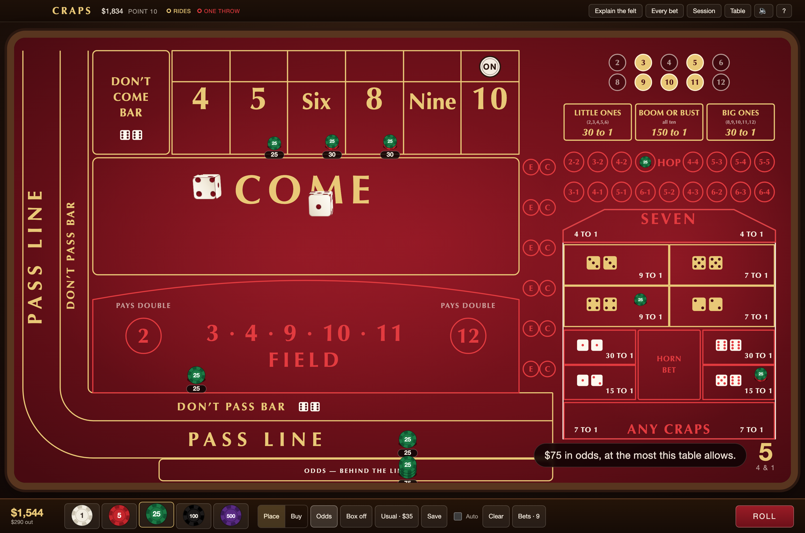
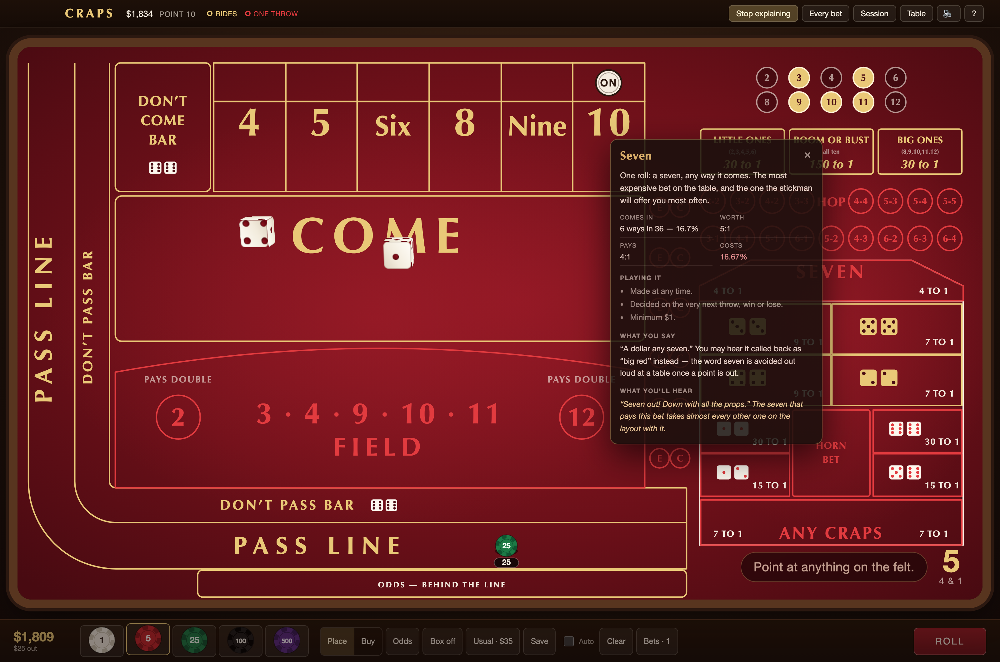

# Craps

A Vegas craps table in your browser. Every bet printed on the felt is playable,
the table refuses what a dealer would refuse and tells you why, and the dice are
genuinely thrown — the result drawn from your browser's cryptographic random
source before they leave the shooter's hand.

**Play it: [lhstart.com/games/craps](https://lhstart.com/games/craps/)**



No accounts, no advertising, no network requests of its own. Open it once and it
plays on a plane.

## Running it

```bash
npm install
npm run dev
```

`npm run build` writes a self-contained site to `dist/` that runs from any
folder, at any path, with no server.

## The table

The layout is a specific one, drawn from photographs of a real burgundy felt.
The box numbers are 4, 5, Six, 8, Nine and 10 — this is not a crapless table —
and there is no Big 6 or Big 8, because that table does not have one.

| | |
| --- | --- |
| **The line** | Pass, Don't Pass (bar 12), Come, Don't Come, and odds behind any of them |
| **The box** | Place, Buy and Lay on all six numbers |
| **The field** | 2 · 3 · 4 · 9 · 10 · 11 · 12, with 2 and 12 both paying double |
| **The centre** | Any Seven, Any Craps, Aces, Ace Deuce, Yo, Boxcars, the Horn, C & E |
| **Hardways** | 4 and 10 at 7:1, 6 and 8 at 9:1 |
| **Hops** | All seventeen circles — four doubles at 30:1, thirteen easy ways at 15:1 |
| **The bonus row** | Little Ones, Big Ones and Boom or Bust, on one shared tracker |

### The colours mean something

On a real felt they do not — they are the layout's branding. On the table this
one is drawn from they are worse than meaningless: the come box is printed red
like the one-roll props even though it rides as long as the line does, and the
field is gold like the box numbers even though it is over on the very next
throw. Those two are exactly the ones people get wrong.

So here **gold rides** and **red is one throw**. Cream is not a bet at all — the
payouts, the printed dice, the markers. Which makes the exceptions visible
instead of hidden: the hardways sit in the middle of the prop box and are gold,
because they ride; the field sits out with the line and is red, because it does
not.

This is the only place the game deliberately departs from the photograph.

## The rules it actually keeps

Most of the work is in the things a table says no to.

- **Increments.** Place 6 and 8 want multiples of $6 so 7:6 pays in whole
  dollars; 5 and 9 want fives; odds behind a 5 must be even. A bet that cannot
  be paid correctly is refused when it is made, and the table says what to make
  it — *"the six pays in $6 steps, make it $30"* — which is what a dealer says
  while sliding the chips back.
- **Odds caps.** 3-4-5x by default: three times on the 4 and 10, four on the 5
  and 9, five on the 6 and 8, so every point wins exactly six times the flat bet
  and the dealer never has to think about it. The don't side is quoted the same
  way — lay whatever it takes to win six times your bet. Schemes from 1x to 100x
  are in the table settings.
- **Behind the line.** Odds go on the apron *outside* your flat bet, not beside
  it. That is what the name means: at a table you can read a player's odds off
  the felt without asking, because they are the only chips out there.
- **Working and off.** Place bets, buys, hardways and come odds are off on a
  come-out unless you call them on. Which is what makes a come-out seven
  survivable: your come bet on the six loses, but its odds were never at risk
  and come back. Lay odds on a don't come bet work, as they do at most houses —
  the seven is what they are waiting for.
- **Contract bets.** The pass line and a come bet on a number cannot be taken
  down once they have a number. A line bet *can* be picked up before the
  come-out throw, because until there is a point it is only chips on the felt.
  Nor can anything be added to a come bet once the dealer has moved it to its
  number — the only way onto the number is through the come box. Odds go
  behind it; nothing else does.
- **Vigorish.** 5% on a buy, charged on the stake; 5% on a lay, charged on the
  win. A dollar minimum either way, rounded down — which is most of why a small
  buy is a bad bet. A commission pays for one decision: up front when the bet
  goes up, and out of every win that leaves it standing — *"pay the buy, take
  the vig"*. Taken down before it is decided, the commission comes back.
- **The line rides.** When the point is made the dealer pays your pass line by
  setting an equal stack beside it. You pick up the payout; the original is
  still there as your bet for the next come-out. Almost nobody picks it up.
- **Press and regress.** A winning place bet is paid alongside and stays where
  it is. Press puts up as much of the win as the spot can be paid on and hands
  back the rest — the six pays $35, press it to $60, five back. Every bet
  remembers what you last deliberately set it to, so *"back to thirty"* still
  means thirty three presses later.
- **Hands off while the dice are out.** The roll is drawn, and saved, before
  the dice leave the hand. From then until the crew has finished paying it
  nothing on the felt can be made, moved or taken down, and closing the tab
  does not take it back — the roll is settled when you return.
- **The settlement order.** When a number hits, the felt pays in the order the
  crew works: the centre first, then the box, then the come, then the line. It
  is not cosmetic — a come bet moving onto the six has to happen *after* the six
  has paid, or a bet that was still in the come box gets paid for a number it
  was not yet on.

### The bonus row

Little Ones, Big Ones and Boom or Bust share one set of markers rather than
three, which is how the tables that run it do it. When Little fills it pays and
comes down, but the markers stay lit — Big and Boom are still running on the
same numbers. Which also means Little cannot go up again in that hand: every
number it wants is already marked, so it would be a certainty rather than a bet.
A seven wipes the board and the next shooter can win it again.

Once the first throw has been made the bets are contracts: they cannot come
down, and they are paid at the rate they were bet at, whatever the table is
changed to in the meantime.

The price is the one thing on this felt that genuinely differs house to house,
so it is a setting: **30 to 1, 31 to 1, or 34 to 1**. A house printing *31 for
1* is printing 30 to 1 — "for one" includes your stake coming back and "to one"
does not — which is why the same bet reads as 31 at one table and 30 at another.
The rate itself does differ, and it matters: 18.30% at 30 to 1 makes these the
most expensive bets on the layout, and 7.76% at 34 to 1 makes them among the
better long shots.

## The dice

A rigid-body simulation of two dice is not provably fair — whatever bias is in
how the throw is generated ends up in the result, and however small that is, a
casino game cannot have it. But a result drawn in advance and played back as a
canned animation is not a throw either. It is the same twelve seconds every time
and you can feel it.

You can have both, and the way through is the cube itself.

A cube is unchanged by any of the twenty four rotations that map it onto itself.
Its collision geometry, its inertia — everything the physics touches — is
identical; the only thing those rotations move is the pips. So:

1. Draw the result from `crypto.getRandomValues`. A real one in thirty six.
2. Throw the dice and simulate. See what they happen to land on.
3. Rotate each die's *starting* orientation by the symmetry that carries the
   face it landed on round to the face that was drawn.
4. Play it back. Same throw, different pips.

In exact arithmetic one pass would always be enough. In floating point it is not
quite: the twisted die's corners come out of the rotation in a different order,
differing in the last decimal place, and a bouncing cube amplifies that. So it
throws, looks, twists and throws again — 1.97 passes on average.

The guarantee does not rest on the arithmetic being perfect. It rests on the
result being read from the throw that gets played back, never asserted over it:
**what you watch land is what you get paid for, always.** The test suite says so
ten thousand throws at a time. A throw that would not converge — never yet seen,
in 180,000 of them — is not thrown again: that would make the hard-to-land
results rarer than one in thirty six. The dice are turned to the drawn faces as
they come to rest instead.

Three things the physics needed, none of which were obvious until measured:
contacts sorted by where they are in the world rather than by corner index (a
symmetry permutes the indices); position corrected once per surface rather than
once per contact (four corners each asking to be lifted clear left dice hovering
for ever); and no bounce below a closing speed, because craps felt is not a
billiard table and a die that is down stops.

The dice are six divs a cube, turned by the quaternion the physics produced — no
WebGL, no library. Two dice is not enough geometry to be worth a renderer.

## Training mode

**Explain the felt**, in the header, turns clicks into questions. Point at any
spot and it tells you about that one bet.



The numbers are derived from the same code that settles the bets — the chance
comes from settling all thirty six throws against the bet itself — so a lesson
cannot describe a bet the felt no longer makes. Only the English is
hand-written, and the English is the part that is hard to find anywhere else,
because it is what nobody at a busy table will stop to tell you: that odds on
the line you place yourself but odds on a come bet go to the dealer, that you
never say "eleven" because it sounds like seven, that Any Seven comes back as
*"big red"* once a point is out.

It is also where the one genuinely counter-intuitive thing about a pay table
becomes obvious. **Any Seven pays 4:1 and Any Craps pays 7:1, and Any Craps is
the cheaper bet** — 11.1% against 16.7%. Both are short exactly one unit of true
odds; the house keeps the same single unit either way. What differs is what that
unit is a share of. One in six is 16.7%; one in nine is 11.1%. The bigger payout
spreads the same shortfall over more money.

## Sound

Three cues, synthesised rather than sampled: dice on cloth, a cash register on
anything paying 3:1 or better, and the sound of a table being cleared on a seven
out. All three are short, percussive and noisy, which is what an oscillator and
a filter are good at — and recording them would mean either a network request,
which this game does not make, or a few hundred kilobytes of samples in a build
that is under a hundred. Every throw is slightly different, because the
parameters are jittered rather than replayed.

There is a switch in the header, and it is remembered.

## Your data

Everything stays in your browser. There is no server and no account, and the
game makes no request of its own — disconnect and it plays exactly the same.
Your rail, your bets and your figures are in localStorage; clearing your browser
data removes them. Games in progress are saved as you play, so you can close the
tab and pick up mid-hand.

## Building on it

Plain JavaScript and React, built with Vite. No runtime dependencies beyond
React itself.

```
src/
  lib/
    bets.js      every bet, what it pays, when it works, what may come down
    rules.js     resolve(roll, table) -> the whole table's outcome. Pure.
    table.js     the state machine, and every way a player can change the felt
    limits.js    minimums, increments, odds caps, vig, and what is refused
    dice.js      the deterministic rigid-body throw, and the symmetry trick
    rng.js       crypto-backed, seedable for tests and the simulator
    layout.js    the felt as coordinates — every region and where its chips go
    school.js    one bet explained, with the numbers derived from the catalogue
    edges.js     what each bet costs, shared by the rules screen and the audit
    calls.js     what the stickman says
    sound.js     three cues, synthesised
    bank.js      chips and denominations
    storage.js   the saved game, the figures, the preferences
  components/    Felt, Chips, Dice, Rail, Crew, Lesson, Dialogs
public/          manifest and icons, copied to the build as-is
test/            the engine, the felt, the dice, the lessons, the cues, the audit
```

The rules live apart from the interface, so they can be tested directly:

```bash
npm test
```

**1,656 assertions** across eleven files. Two are worth knowing about.

**Money is conserved.** Across thirty thousand randomised rolls, what the player
holds — the rail plus everything still on the felt — moves by exactly the
winnings less the losses and by nothing else. That is the check that catches a
double payment, a bet paid but not taken down, or a stake returned twice.

**The audit is exact, not sampled.** Every bet but the two line bets is decided
by a single throw against a fixed set of outcomes, so its expectation is
computable: ask the catalogue's own `settle()` what each of the thirty six
throws does, and do the arithmetic. All of them land on their published figure
to three decimals — no sampling, no tolerance. The line is derived from first
principles rather than quoted, which comes to 244 in 495. And the last check is
the one the file exists for: **nothing on this felt has a negative edge.** Odds
are the only free bet in the building, every odds bet is free, and nothing else
is.

Buys and lays are checked through the engine itself as well, left up for life
the way nearly everybody plays them: value iteration over every table state the
bet can be in, across all thirty six throws, until the expectation converges.
Each lands on its published figure — which is how it came to light that the
commission used to be charged only once, and a $100 buy on the four left up was
costing 3.23% rather than 4.76%.

### The browser harnesses

Some things cannot be checked by reading the source, so they are measured in a
real browser.

```bash
npm run probe     # click all 50 printed spots, check the right bet answers
npm run play      # play a hand end to end, fail on anything the page says
npm run fits      # four viewports: nothing off-screen, nothing under 44px
npm run offline   # build it, then play with every request refused
npm run shot      # photograph the table
npm run icons     # redraw the app icons and the portal cover
```

Every one of these was written after a bug that reading could not have found.

`probe` earned its place immediately: it found that *none* of the spots were
clickable, because a box on a craps layout is an outline with felt inside it and
only the 2px printed border was answering. `fits` found the table running off
the side of a phone — twice, and for the same reason both times, a CSS grid
sizing its implicit tracks to their contents. `play` caught the payout amounts
flying up from the corner of the table instead of off their bets, because an
animated CSS transform *replaces* an element's positioning transform rather than
composing with it.

`offline` is the one that matters most. The claim this game makes is that it
needs no network at all — easy to believe, easy to break, and none of the ways
it breaks fail loudly. They fail on a plane. So it serves the build from a
folder, records every request, fails on anything leaving the origin, and then
plays a hand with *every* request refused.

### Measuring the house

```bash
npm run sim                          # every bet, against what it should cost
npm run sim -- --strategy pass-odds  # play a strategy and report the damage
```

`sim.mjs` drives the engine headless — no React, no felt, no dice — which is the
whole reason `src/lib` has no interface code in it. It measures each bet against
the figures in `edges.js`, which are the same figures the rules screen shows the
player, so a payout that is a shade too generous moves the measurement away from
what the game claims and shows up as a flagged row.

Flat pass line with 3-4-5x odds comes out at **0.371% of action** against a
published 0.374%.

## The portal

Served from `lhstart.com/games/craps/`, alongside sudoku, snowline and evolve.
The build is relative (`base: './'`), it writes `dist/offline.json` so the
portal's service worker knows what to keep on the device, and it includes two
shared scripts — the exit chip and the offline registration — from the portal's
own origin. Those are absolute paths, so they simply do not load on a dev
server, which is intentional: no exit chip when there is nothing to exit to.

```bash
npm run deploy
```

Builds, refuses to upload a build with root-absolute asset paths, uploads to
this game's own bucket, and invalidates just that prefix. Needs an authenticated
session (`aws login`). Eight files, 570 kB — small enough that the shelf caches
it without being asked. The offline contract is written up in the
[lhstart README](https://github.com/Guarrdon/lhstart).

## Licence

MIT — see [LICENSE](LICENSE).
